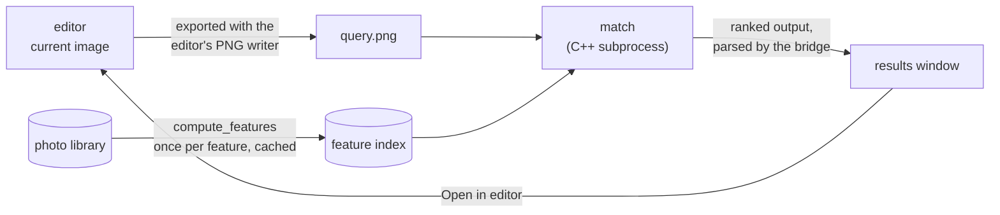

# Image Studio


**A desktop photo editor that can find visually similar photos in your library.**
Edit a photo, choose *Search → Find similar…*, and Image Studio shows the photos
in your library that look most like it - ranked by color, layout, texture, or by
features learned by a deep neural network.

## What it does

- **Edit photos** - open PNG, JPEG, BMP or PPM files, brighten or darken them,
  convert them with six greyscale modes, and watch a live RGB + intensity
  histogram update with every change. Several images can be open at once.
- **Find similar photos** - search with the photo *as you've edited it*. Results
  appear as thumbnails ranked by similarity, and any of them opens in the editor
  with one click.
- **Choose what "similar" means** - five handcrafted image features (color,
  spatial layout, texture and combinations), or embeddings from a ResNet-18
  network for search by content.
- **Search any folder** - point it at a photo library; it indexes the library
  once and re-indexes only when photos are added, removed or changed.

## What it demonstrates

| Area | Where it shows up |
|---|---|
| **Computer vision and image retrieval** | rg-chromaticity color histograms, top/bottom spatial histograms, Sobel gradient texture, matched distance metrics, top-N content-based retrieval over a feature index - [`search-engine/`](search-engine/) |
| **Deep learning** | a pretrained ResNet-18 used as a feature extractor (transfer learning); on the sample library its embeddings found 16 of 16 same-item matches in the top 4, against 5-9 for the handcrafted features - [`tools/`](tools/embed_library.py) |
| **Software architecture** | MVC throughout; Command, Strategy and Factory patterns in the editor; a new feature added by composing the editor's public API, without modifying its code - [`editor/`](editor/), [`studio/`](studio/src/studio/) |
| **Systems integration** | Java and C++ connected across a process boundary: subprocess management, timeouts, output parsing, error reporting, and a cached index with invalidation - [`SearchEngineBridge`](studio/src/studio/SearchEngineBridge.java) |
| **Desktop UI** | Swing; indexing and search run off the UI thread, so the editor stays responsive |
| **Build, test and CI** | one `Makefile` for Java, C++ and Python; builds against OpenCV 4 and 5; 27 headless checks including end-to-end searches; GitHub Actions on every push |

## Quickstart

Needs a JDK 17+, `make`, a C++17 compiler, OpenCV and `pkg-config`
(macOS: `brew install opencv pkg-config`).

```bash
git clone https://github.com/alaratwork/Image-Studio.git && cd Image-Studio
make && make run-studio   # build everything and open Image Studio
make test                 # 27 checks, including end-to-end Java → C++ searches
```

## Using Image Studio

1. **Load Image** and edit as you like - every operation creates a new image in
   the list, so the original is kept.
2. **Search → Find similar…** (⇧⌘F on macOS, Ctrl+Shift+F elsewhere) searches
   the photo library for the selected image.
3. **Search → Match by** picks the feature type; **Search → Photo library…**
   picks the folder to search (the bundled `samples/library` by default).
4. In the results window, **Open in editor** loads any match into the editor.

## How *Find similar* works



1. The photo as currently edited is written to a temporary PNG with the
   editor's own writer, so a brightened or greyscaled image is searched as-is.
2. The bridge indexes the library with the engine's `compute_features` - once
   per library and feature type. The index is cached and rebuilt only when the
   library changes.
3. It runs the engine's `match` program as a subprocess, with a timeout and
   readable errors, and parses the ranked results.
4. Results open in a window of thumbnails, from which any photo can be loaded
   back into the editor.

The editor and the search engine are each kept exactly as written: `studio/`
composes the editor's public classes (`View`, `ImageDatabase`, `ImageController`,
`WritePNG`) and talks to the engine only through its command-line programs.

## Known limitations

- Deep-feature search is command-line only for now: the engine's `dnn` mode
  looks a query up by file name in the embeddings file, so it can only search
  *from* photos already in the library, not from an edited image.
- The editor's image reader ignores EXIF orientation, so phone photos tagged as
  rotated open sideways. The sample library has the rotation applied to the
  pixels, so it looks right everywhere.
- The sample library is 33 photos; the engine was designed for libraries of
  around a thousand.

## Repository layout

```
editor/            Java Swing editor (MVC + Command / Strategy / Factory)
search-engine/     C++17 / OpenCV content-based image retrieval engine
studio/            Find similar: the Java-to-C++ bridge, Search menu, results window, tests
tools/             ResNet-18 embeddings for the engine's deep-feature mode
samples/library/   33 of my own photos (downsized, metadata removed)
docs/images/       screenshots
Makefile           one build for everything
```

MIT licensed - see [LICENSE](LICENSE).
