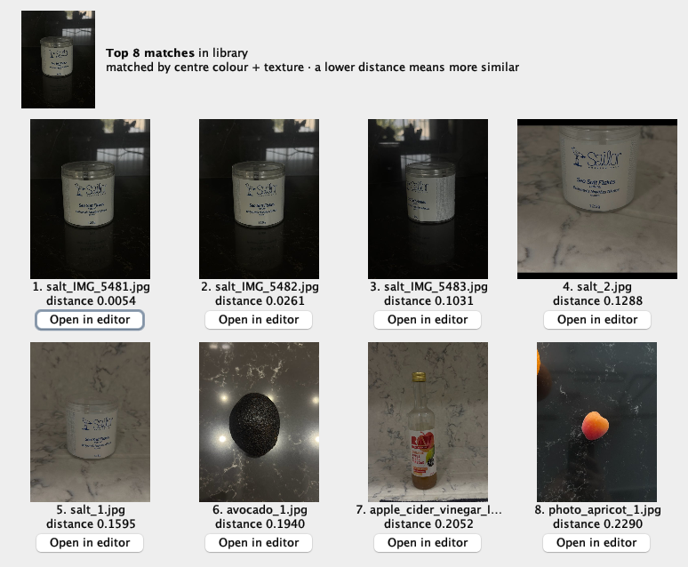
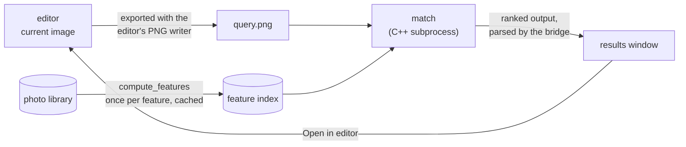

# Image Studio

**A desktop photo editor that can find visually similar photos in your library.**
Edit a photo in the Java / Swing editor, choose *Search → Find similar…*, and a
C++17 / OpenCV search engine ranks your library by how much each photo looks
like the one you're editing - by colour, layout, texture, or learned ResNet-18
features.

<p align="center">
  
</p>

| Component | Stack | What it does |
|---|---|---|
| **[Editor](editor/README.md)** | Java 17+, Swing | load / save PPM, PNG, JPEG, BMP · brighten and darken · six greyscale modes · live RGB + intensity histogram |
| **[Search engine](search-engine/README.md)** | C++17, OpenCV | indexes a folder once, then answers "top N most similar" · six feature types, each with a matched distance metric |
| **Studio** (`studio/`) | Java | the bridge between them: *Find similar* inside the editor, backed by the engine |
| **Embeddings** (`tools/`) | Python, PyTorch | ResNet-18 embeddings for any photo library, for the engine's deep-feature mode |

## How *Find similar* works



1. The photo **as currently edited** is written to a temporary PNG with the
   editor's own writer, so a brightened or greyscaled image is searched as-is.
2. The bridge indexes the library with the engine's `compute_features` -
   once per library and feature type. The index is cached and rebuilt only when
   a photo is added, removed or changed.
3. It runs the engine's `match` program as a subprocess, with a timeout and
   readable errors, and parses the ranked results.
4. Results open in a window of thumbnails; *Open in editor* loads any of them
   into the editor's image list. The search runs off the UI thread, so the
   editor stays responsive while a new library is indexed.

## Does the feature type matter? (yes)

Five queries against the 33-photo sample library, counting how many of the top
4 results show the same item. Some items have fewer than four other photos, so
the most any feature can score is 16.

| Feature | What it compares | Same-item matches in top 4 |
|---|---|---|
| `baseline` | the 7×7 centre pixels | 9 / 16 |
| `hist` | rg-chromaticity colour histogram | 5 / 16 |
| `multihist` | top-half and bottom-half colour histograms | 9 / 16 |
| `texture` | colour + Sobel gradient-magnitude histogram | 8 / 16 |
| `custom` | centre colour + whole-image texture | 7 / 16 |
| **`dnn`** | **ResNet-18 embeddings, cosine distance** | **16 / 16** |

Learned features found every possible match; the handcrafted ones found
between 5 and 9. It's a small library and five queries, so treat this as a
demonstration rather than a benchmark. Any row can be reproduced, e.g.
`make demo FEATURE=hist QUERY=samples/library/photo_lemon_1.jpg`, or
`make demo-dnn QUERY=samples/library/photo_lemon_1.jpg` after `make embeddings`.
(Queries: `photo_lemon_1`, `salt_IMG_5481`, `ketchup_bottle_IMG_5476`,
`avocado_1`, `photo_apricot_1`.)

## Quickstart

Requirements: a JDK 17+, `make`, a C++17 compiler, OpenCV 4 or 5, and `pkg-config`.

```bash
make                # builds the editor, the search engine and Image Studio
make run-studio     # opens Image Studio: load a photo, then Search → Find similar…
make demo           # command line: the photos most like a salt container
make test           # 27 checks, including end-to-end Java → C++ searches
```

Deep-feature search (optional, needs Python with `tools/requirements.txt`):

```bash
pip install -r tools/requirements.txt
make embeddings     # ResNet-18 embeddings for samples/library
make demo-dnn       # the same salt query, ranked by learned features
```

The original editor still runs on its own with `make run-editor`.

## Engineering notes

- **No changes to either original codebase.** `studio/` is a new package that
  composes the editor's public classes (`View`, `ImageDatabase`,
  `ImageController`, `WritePNG`) and talks to the engine only through its
  command-line programs. The root `Makefile` drives the engine's own makefile
  with OpenCV flags from `pkg-config` instead of editing it, so the same source
  builds against Homebrew's OpenCV 5 on macOS and Ubuntu's OpenCV 4 in CI.
- **The bridge is testable without a display.** It has no Swing dependency;
  its checks cover output parsing, input validation, index caching and
  invalidation, and real searches through the C++ engine - including one that
  goes through the editor's image reader and PNG writer.
- **Design patterns where they earn their place.** The editor is MVC with
  Command, Strategy and Factory; the engine is MVC too, where a new feature type
  is one new function in the model.
- **CI** builds everything, runs an end-to-end search and runs the bridge
  checks on every push.

## Known limitations

- Deep-feature search is command-line only for now: the engine's `dnn` mode
  looks a query up by file name in the embeddings file, so it can only search
  *from* photos already in the library, not from an edited image.
- The editor's image reader ignores EXIF orientation, so phone photos tagged as
  rotated open sideways. The sample library has the rotation applied to the
  pixels, so it looks right everywhere.
- The sample library is 33 photos; the search engine was built for libraries
  of around a thousand.

## Repository layout

```
editor/            Java Swing editor (MVC + Command / Strategy / Factory)
search-engine/     C++17 / OpenCV content-based image retrieval engine
studio/            Find similar: the Java-to-C++ bridge, the Search menu, results window, tests
tools/             ResNet-18 embeddings for the engine's deep-feature mode
samples/library/   33 of my own photos (downsized, metadata removed)
docs/images/       screenshots
Makefile           one build for everything
```

The search engine began as a project for Northeastern's CS5330 (Pattern
Recognition and Computer Vision).
