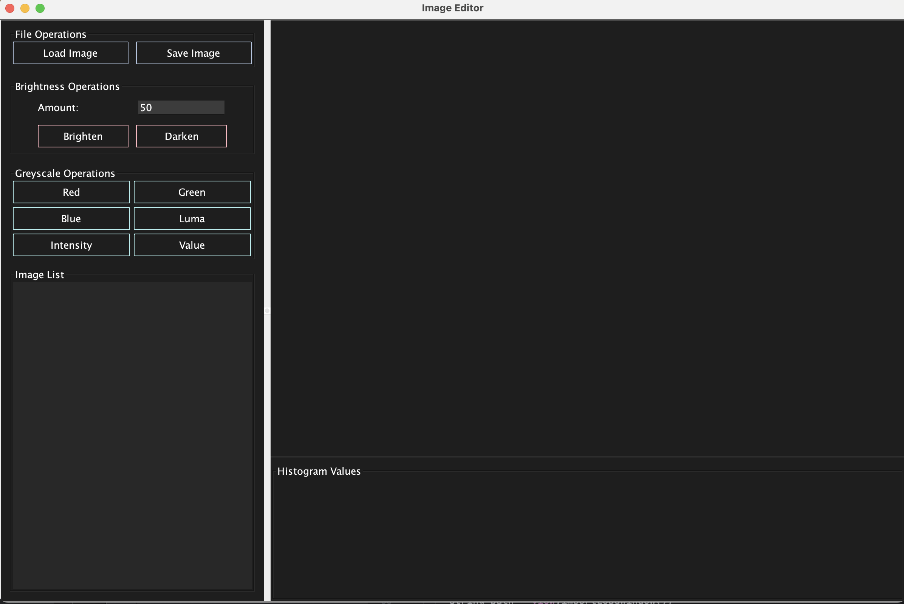
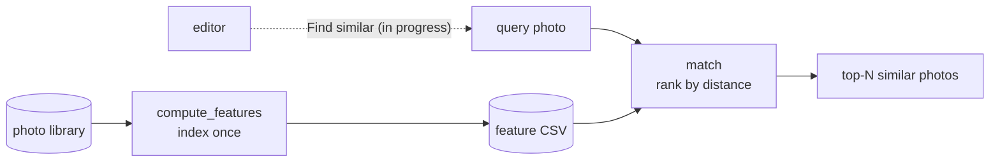

# Image Studio

**A desktop photo editor and a visual search engine, built to work together.**
The editor (Java / Swing) loads, edits and saves photos; the search engine
(C++17 / OpenCV) ranks a photo library by how visually similar each image is to
a query - by colour, spatial layout, texture, or learned ResNet-18 features.

<p align="center">
  
</p>

| Component | Stack | What it does | Details |
|---|---|---|---|
| **Editor** | Java 17+, Swing | load / save PPM, PNG, JPEG, BMP · brighten and darken · six greyscale modes · live RGB + intensity histogram · several images per session | [editor/](editor/README.md) |
| **Search engine** | C++17, OpenCV | indexes a folder once, then answers "top N most similar" queries · six feature types, each with a matched distance metric · command-line and GUI views | [search-engine/](search-engine/README.md) |



## Quickstart

Requirements: a JDK 17+, `make`, a C++17 compiler, OpenCV 4 or 5, and `pkg-config`.

```bash
make              # builds build/image-editor.jar and the three search-engine programs
make run-editor   # opens the editor
make demo         # indexes samples/library, then finds the photos most like a salt container
```

`make demo` should list the four other salt photos as the top matches. Try another
feature or query with `make demo FEATURE=hist QUERY=samples/library/ketchup_bottle_IMG_5476.jpg`.
Feature types: `baseline`, `hist`, `multihist`, `texture`, `custom` (and `dnn`,
which reads precomputed ResNet-18 embeddings - see the
[search engine notes](search-engine/README.md)).

## Engineering notes

- **Both codebases are kept exactly as written.** The root `Makefile` drives
  the engine's own makefile with OpenCV flags from `pkg-config` instead of
  editing it, so the same source builds against Homebrew's OpenCV 5 on macOS
  and Ubuntu's OpenCV 4 in CI.
- **Design patterns where they earn their place.** The editor is MVC with
  Command (one class per operation), Strategy (every filter implements
  `IOperation`) and Factory (format-specific readers and writers). The engine is
  MVC too: adding a feature type is one new function in the model.
- **Index once, query cheaply.** `compute_features` writes a feature CSV per
  feature type; `match` and `gui` only read it.
- **CI** builds both components and runs an end-to-end search on every push.

## Roadmap

- **Find similar, inside the editor** - pick *Search → Find similar…* on the
  photo you're editing and see the closest matches from your library. In
  progress on the `feature/find-similar` branch.

## Repository layout

```
editor/            Java Swing editor (MVC + Command / Strategy / Factory)
search-engine/     C++17 / OpenCV content-based image retrieval engine
samples/library/   33 of my own photos for trying the search (downsized, location metadata removed)
Makefile           one build for both components
```

The search engine began as a project for Northeastern's CS5330 (Pattern
Recognition and Computer Vision).
